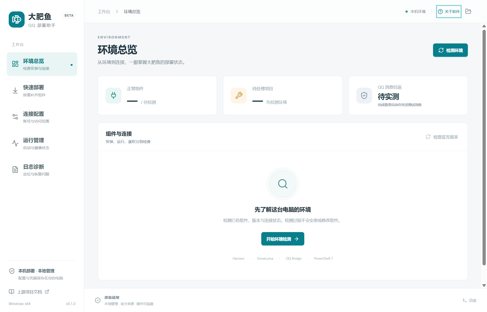
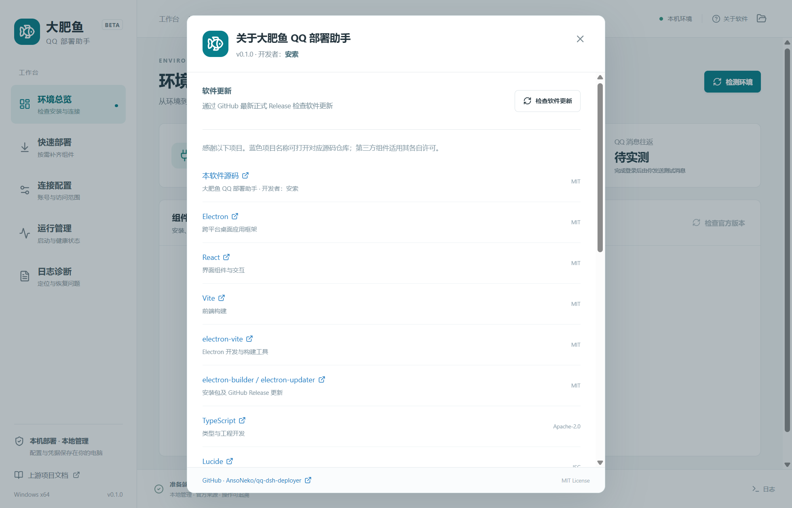

# 大肥鱼 QQ 部署助手

Windows 中文桌面工具，集中检测、部署和管理 **DeepSeek Harness 官方桌面版 + SnowLuma + QQ Bridge**。使用 Electron、React、TypeScript、Vite 开发。

**开发者：安索** · [源码仓库](https://github.com/AnsoNeko/qq-dsh-deployer) · [下载最新正式版](https://github.com/AnsoNeko/qq-dsh-deployer/releases/latest)





### 关于软件与自动更新

原生菜单“软件 → 关于软件”、界面右上角“关于软件”均可查看开发者和引用项目，蓝色链接打开对应源码仓库。

软件启动后查询本仓库的最新正式 GitHub Release，也可通过菜单或关于窗口手动检查。安装版发现更高版本后自动下载并验证 SHA-512，完成后点击“重启安装新版”；部署任务进行中禁止安装应用更新。普通退出不会自动安装更新。

便携版同样从 GitHub 最新正式 Release 自动下载，校验 GitHub 返回的 SHA-256 摘要。下载完成后点击“打开新版位置”，退出当前程序后替换原 EXE。首版便携包不原地覆盖正在运行的自身文件。

不下载 Draft / Prerelease，不降级；首次发版前、GitHub 限流或网络异常会显示实际失败信息，不误报“已是最新”。

## 直接使用

打开 `dist` 中的安装版或便携版 EXE。工具自身无需系统 Node.js 或 .NET。下载、解压和第三方程序的数据会占用额外空间。

1. **环境总览 → 开始环境检测**：先识别已有安装、版本、进程和本机连接状态，不安装软件。
2. **连接配置 → 导入已有配置**：已有桥接时优先导入，保留管理员、白名单、模型及端点。自定义安装可手动选择程序和目录。多个安装可在组件详情选择后保存。
3. **快速部署**：只勾选缺少或准备升级的组件。先预览下载来源、精确版本及配置改动，再确认执行。最后一步自动扫描环境、备份并应用实际程序路径、已验证的 Harness API 及唯一匹配的 OneBot 地址和 HTTP/WS 令牌；已有管理员、白名单、模型和其他配置保留。
4. 按任务提示完成 Harness 首次启动和账号配置。SnowLuma 启动后，在部署步骤下方「SnowLuma 后台登录」复制初始密码，使用 `admin` 登录后台并设置新密码、完成协议确认及 QQ 登录；运行管理中也可查看和复制初始密码。安装 desktop 插件前，从 Harness 托盘菜单**完全退出**。
5. **连接配置**填写管理员 QQ、允许回应的群 / 好友；空白名单不会全部放行。HTTP 与 WebSocket 地址、令牌分别处理。
6. **运行管理**启动服务；通过助手启动 / 重启 QQ Bridge 或点击打开控制台，都会自动带入当前控制台访问令牌。运行管理和部署完成后的步骤面板支持查看、复制令牌。端点变化后可使用“检测并应用实际配置”；助手管理的桥接会自动重启应用新配置。最后在白名单群 / 私聊发送一条消息，确认 QQ 收到 AI 回复。安装完成和端口可连接均不等于消息往返已通过。

### PowerShell 7

快速部署支持从微软官方 GitHub Release 安装固定版本 PowerShell 7。使用独立 ZIP 目录，无需管理员权限，不替换 Windows PowerShell 5.1。

勾选“加入当前用户 PATH”后，追加目录并保留已有条目。**重新启动终端及 AI 程序后**，可执行：

```powershell
pwsh -NoProfile -Command '$PSVersionTable.PSVersion'
```

独立安装不注册 Microsoft Update、远程管理或文件关联。更新通过部署助手检查；为避免覆盖未知数据，已有非工具管理目录不会直接替换。

## 各组件处理方式

| 组件          | 首版行为                                                                                       |
| ------------- | ---------------------------------------------------------------------------------------------- |
| Node.js / npm | 检测现有版本，或安装专用运行时；不修改系统 PATH                                                |
| PowerShell 7  | 检测及独立安装，可选追加用户 PATH                                                              |
| Git           | 检测与版本查询；归档部署无需 Git                                                               |
| QQ            | 检测、打开已有客户端；登录状态以网关为依据，不自动安装 QQ                                      |
| Harness       | 下载锁定摘要且签名有效的官方安装程序，通过官方向导安装                                         |
| SnowLuma      | 在已取得相关书面授权范围内官方下载、校验、解压；用户完成首次设置和登录                         |
| QQ Bridge     | 固定提交归档、`npm ci` 及 postinstall，保留 config/state/roles/audio；工具管理版本支持失败恢复 |
| preset / MCP  | 使用官方桌面版命令管理 desktop 插件，保留其他插件，配置前备份                                  |

**SnowLuma 首版不覆盖已有网关账号数据目录**，已有安装升级使用其官方流程，或选择新的组件目录。非工具管理的桥接目录可导入配置、安装依赖以外的插件配置操作；源码升级请保留原目录并使用新的工具管理目录。

## 版本与连接

发行清单在 `resources/catalog.json`，记录固定版本、下载地址、SHA-256，以及 Harness 官方安装程序的签名指纹。官方下载链接变更内容后，摘要不一致将停止安装，需要维护者重新核验并更新清单。工具不会把“官方最新”自动当成“已兼容”。

- 桥接 v0.2.1-r1 的上游声明适配 Harness 0.2.0-rc.2 / 0.2.1-rc.2。
- SnowLuma 2.1.1 组合的实际 QQ 往返仍需用户实测。
- Harness 桌面版使用 `desktop` profile，API 端口可变。扫描按所选进程关联的监听端口查询，并使用本机持久化签名凭据和当前 `{ args: {} }` 请求格式验证只读 preset RPC；不读取旧启动日志 token。每次通过助手启动或重启桥接前重新检测，再将当前地址写入桥接配置，避免继续使用旧端口。
- 桥接控制台使用独立的 `x-console-token` 鉴权。检测同时检查其 `dshReady` 和 SnowLuma 上游状态；桥接进程存在但 Harness 未连接时显示待处理，不能作为全链路正常。
- 插件配置安装通过桌面版自带 `resources/runtime/cli/bin/dsh.cmd`，不调用 npm 版 CLI 改写 desktop。
- 完整安装 desktop 插件后，助手重新启动 Harness 并验证 API；首次登录未完成时明确等待用户操作，随后再应用实际连接配置。多份 OneBot 配置无法唯一匹配时保留现有连接并提示选择；管理员 QQ 不作为网关机器人账号猜测依据。
- 网关分别检查 HTTP `get_login_info/get_status` 和 WS 握手；离线、鉴权失败、426 端口错误及 `good=false` 独立提示。
- 工具管理的桥接在固定提交源码上应用一处有锚点检查的 `split-ws-token-v1` 适配：WS 客户端优先使用独立 `wsAccessToken`，HTTP 继续使用原 accessToken。上游版本及适配标识记录在安装标记中。

## 数据、备份与退出

默认数据在 `%LOCALAPPDATA%\QQDshDeployer`，组件默认位于其 `components` 子目录。设置为 JSON，令牌经 Windows `safeStorage` 加密。桥接必需的配置令牌仍遵循上游文件格式；不要公开分享整个数据目录。

配置修改和插件安装生成备份。日志诊断可恢复；后续用户修改过的文件不会被覆盖。恢复前停止桥接并完全退出 Harness。恢复操作保留原始配置字节，但不会自动卸载包缓存或重置聊天状态。

任务运行时关闭窗口会隐藏到托盘；“取消任务并退出”会取消当前安装步骤。正常退出助手不停止已启动的第三方服务。强制停止只操作本次助手启动并仍记录的进程，外部已有进程通过官方界面退出。

日志与诊断不导出配置原文、签名密钥或聊天状态。第三方服务详细输出保存在本机 `harness-local.log`、`snowluma-local.log`、`bridge-local.log`，可能包含登录信息、初始密码或消息内容，均不进入诊断导出。SnowLuma 首次 WebUI 密码会自动从本机日志提取，并核验是否匹配当前安装的密码哈希；仅在部署步骤和运行管理的登录面板显示，不进入助手日志或诊断。重启 SnowLuma 后刷新为新的初始密码，设置新密码后停止显示旧密码。第三方控制台在系统浏览器打开。用户自行填写的本机路径会出现在诊断中。

## 开发与验证

```powershell
npm ci
npm run dev
npm test
npm run test:e2e
npm run package:win
```

若受 npm 安装脚本审批配置影响，Electron 二进制未下载，可运行 `node node_modules/electron/install.js`。开发启动脚本自动清除父进程继承的 `ELECTRON_RUN_AS_NODE`，避免把 Electron 当作 Node 启动。

真实下载部署验收使用项目内独立目录，**不修改用户 PATH、不安装 Harness、不启动 SnowLuma、不登录 QQ**：

```powershell
$env:QQDSH_LIVE_INSTALL_TEST = '1'
npx vitest run tests/deployment-live.test.ts
```

界面验收截图与报告在 `output/playwright`；真实下载验收在 `output/acceptance`。完整验收边界见 `docs/ACCEPTANCE.md`。

## 上游与授权

- 视频来源：https://www.bilibili.com/video/BV1dEJd6KEwP/
- Harness：https://github.com/deepseek-ai/deepseek-harness
- QQ Bridge：https://github.com/Derpyu520/qq-bridge
- SnowLuma：https://github.com/SnowLuma/SnowLuma
- PowerShell：https://github.com/PowerShell/PowerShell

SnowLuma 安装包不内置。自动化部署功能须在覆盖该用途的书面授权范围内使用；启动后的 EULA、隐私政策和账号设置由用户处理。第三方组件继续适用各自许可，见 `THIRD_PARTY_NOTICES.md`。
